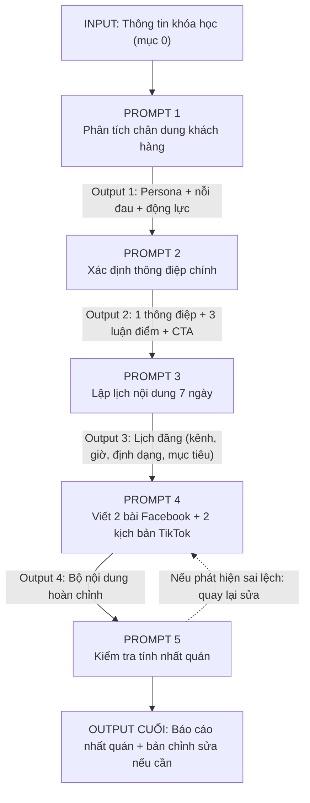

# [Bài thực hành 5] Xây dựng chiến dịch truyền thông tuyển sinh khóa học

**Họ tên:** Hà Gia Bách
**Kỹ thuật sử dụng:** Prompt Chaining (5 prompt liên tiếp)

## 0. Thông tin khóa học (giữ nguyên, không thay đổi)

| Hạng mục | Nội dung |
|---|---|
| Khóa học | Python cơ bản cho người mới bắt đầu |
| Đối tượng | Sinh viên năm nhất |
| Độ tuổi | 18–20 |
| Thời lượng | 8 tuần |
| Mục tiêu chiến dịch | 100 lượt đăng ký tư vấn |
| Kênh truyền thông | Facebook và TikTok |

> Các thông tin chưa được đề bài cung cấp (học phí, lịch khai giảng, địa chỉ, giảng viên) **không được tự bịa**; trong bài dùng chỗ trống `[Link đăng ký tư vấn]`, `[Hotline]` để trung tâm điền sau.

---

## 1. Sơ đồ chuỗi prompt



Dạng văn bản (nếu không hiển thị được sơ đồ):

```
[Thông tin khóa học]
        |
        v
PROMPT 1: Chân dung khách hàng ──► Output 1
                                      |
                                      v
PROMPT 2: Thông điệp chính  ◄── (dùng Output 1) ──► Output 2
                                      |
                                      v
PROMPT 3: Lịch 7 ngày       ◄── (dùng Output 1 + 2) ──► Output 3
                                      |
                                      v
PROMPT 4: 2 FB + 2 TikTok   ◄── (dùng Output 1 + 2 + 3) ──► Output 4
                                      |
                                      v
PROMPT 5: Kiểm tra nhất quán ◄── (dùng toàn bộ Output 1–4) ──► Báo cáo
```

**Vì sao không gộp thành một prompt?** Nếu gộp, AI thường viết quảng cáo chung chung, thông điệp không bám vào nỗi đau thật của khách hàng. Tách chuỗi giúp mỗi bước có đầu vào rõ ràng, dễ kiểm tra và sửa từng khâu.

---

## 2. Các prompt trong chuỗi

### Prompt 1 – Phân tích chân dung khách hàng mục tiêu

```
Vai trò: Bạn là chuyên gia marketing giáo dục.
Bối cảnh: Trung tâm đào tạo lập trình tuyển sinh khóa "Python cơ bản cho người mới bắt đầu",
thời lượng 8 tuần, dành cho sinh viên năm nhất (18–20 tuổi). Kênh: Facebook và TikTok.
Mục tiêu chiến dịch: 100 lượt đăng ký tư vấn.
Nhiệm vụ: Phân tích chân dung khách hàng mục tiêu gồm: nhân khẩu học, hành vi dùng
mạng xã hội, nỗi đau (pain points), động lực (motivations), rào cản khi đăng ký,
và kiểu ngôn ngữ họ thích.
Ràng buộc: Không thay đổi thông tin khóa học; không bịa số liệu thống kê.
Định dạng: Bảng Markdown + 1 persona đại diện (tên, tuổi, câu nói đặc trưng).
```

**Output 1 (kết quả):**

**Persona đại diện: "Minh Anh", 18 tuổi, sinh viên năm nhất**

| Nhóm | Nội dung |
|---|---|
| Nhân khẩu học | 18–20 tuổi, vừa vào đại học, đang làm quen môi trường mới, chưa có hoặc có rất ít kinh nghiệm lập trình |
| Hành vi mạng xã hội | Lướt TikTok để giải trí và tìm mẹo học tập; dùng Facebook để theo dõi nhóm lớp, nhóm trường, thông báo học tập; hay xem video ngắn, thích nội dung gần gũi, có ví dụ cụ thể |
| Nỗi đau | (1) Sợ lập trình "khó, khô khan, toàn toán"; (2) Không biết bắt đầu từ đâu, học tự do trên mạng dễ bỏ giữa chừng; (3) Lịch học đại học dày, sợ không đủ thời gian; (4) Sợ mình "không có năng khiếu" nên không dám thử |
| Động lực | Muốn có kỹ năng hữu ích cho việc học và hồ sơ cá nhân; tò mò về công nghệ; muốn có lộ trình rõ ràng và người hướng dẫn |
| Rào cản đăng ký | Ngại hỏi vì sợ bị đánh giá là "chưa biết gì"; chưa chắc khóa học có phù hợp với người mới; muốn được tư vấn nhẹ nhàng trước khi quyết định |
| Ngôn ngữ ưa thích | Ngắn gọn, thân thiện, hài hước vừa phải, tránh thuật ngữ nặng; ưu tiên ví dụ dễ hình dung |

**Câu nói đặc trưng của Minh Anh:** *"Mình chưa biết gì về code hết, liệu học có nổi không nhỉ?"*

---

### Prompt 2 – Xác định thông điệp truyền thông chính

```
Dựa trên chân dung khách hàng dưới đây (Output 1), hãy xác định MỘT thông điệp
truyền thông chính cho chiến dịch.
[DÁN OUTPUT 1]
Yêu cầu: thông điệp phải trả lời trực tiếp nỗi đau số 1 và số 4 của khách hàng;
kèm 3 luận điểm hỗ trợ (chỉ dùng thông tin khóa học đã cho: Python cơ bản, người mới
bắt đầu, 8 tuần); 1 lời kêu gọi hành động (CTA) hướng tới đăng ký tư vấn;
nêu giọng điệu thương hiệu.
Ràng buộc: không hứa hẹn kết quả không có căn cứ (ví dụ "chắc chắn có việc làm").
```

**Output 2 (kết quả):**

**Thông điệp chính:** *"Chưa biết gì về code? Bắt đầu Python từ con số 0 – chỉ trong 8 tuần."*

**3 luận điểm hỗ trợ:**
1. **Dành cho người mới bắt đầu:** khóa Python cơ bản, không đòi hỏi bạn đã biết lập trình trước đó.
2. **Lộ trình rõ ràng, gọn trong 8 tuần:** biết mình sẽ học gì mỗi tuần, không học lan man.
3. **Được tư vấn trước khi quyết định:** đăng ký tư vấn để hỏi mọi thắc mắc, kể cả những câu "ngại hỏi".

**CTA:** *"Đăng ký tư vấn ngay hôm nay để biết khóa học có hợp với bạn không."*

**Giọng điệu:** Thân thiện, gần gũi như một người anh/chị khóa trên, khích lệ, không áp lực.

**Hashtag chung:** `#Python8Tuan` `#HocLapTrinhTuConSo0` `#SinhVienNamNhat`

---

### Prompt 3 – Lập kế hoạch nội dung 7 ngày

```
Dựa trên chân dung khách hàng (Output 1) và thông điệp chính (Output 2):
[DÁN OUTPUT 1 + OUTPUT 2]
Hãy lập lịch đăng nội dung trong 7 ngày trên Facebook và TikTok.
Mỗi ngày gồm: kênh, khung giờ, định dạng, chủ đề, mục tiêu (nhận biết / quan tâm / hành động).
Ràng buộc: toàn bộ nội dung xoay quanh thông điệp chính; có đủ 2 bài Facebook và
2 video TikTok; các ngày còn lại là nội dung hỗ trợ; ngày cuối có CTA mạnh nhất.
Định dạng: bảng Markdown.
```

**Output 3 (kết quả): Lịch đăng 7 ngày**

| Ngày | Kênh | Khung giờ gợi ý | Định dạng | Chủ đề | Mục tiêu |
|---|---|---|---|---|---|
| 1 | TikTok | 19:30 | **Video 1** (30–45s) | "Sợ code?" – phá vỡ nỗi sợ lập trình | Nhận biết |
| 2 | Facebook | 20:00 | **Bài đăng 1** (ảnh + caption) | Giới thiệu khóa Python cơ bản cho người mới | Nhận biết / Quan tâm |
| 3 | Facebook | 19:00 | Ảnh infographic (hỗ trợ) | Tổng quan lộ trình học trong 8 tuần | Quan tâm |
| 4 | TikTok | 19:30 | **Video 2** (30–45s) | Demo lệnh Python đầu tiên – "dễ hơn bạn nghĩ" | Quan tâm |
| 5 | Facebook | 20:00 | **Bài đăng 2** (ảnh + caption) | Giải đáp "chưa biết gì có học được không?" + CTA | Hành động |
| 6 | Facebook + TikTok | 19:00 | Trả lời bình luận / tin nhắn (hỗ trợ) | Q&A: giải đáp thắc mắc của sinh viên | Quan tâm / Hành động |
| 7 | Facebook + TikTok | 20:00 | Bài nhắc nhở ngắn (hỗ trợ) | Tổng kết tuần + CTA đăng ký tư vấn | Hành động |

**Chỉ tiêu gợi ý theo dõi:** tổng 100 lượt đăng ký tư vấn; theo dõi số lượt xem, tương tác và lượt nhấp vào `[Link đăng ký tư vấn]` theo từng ngày để điều chỉnh nội dung.

---

### Prompt 4 – Viết 2 bài Facebook và 2 kịch bản TikTok

```
Dựa trên chân dung (Output 1), thông điệp (Output 2) và lịch đăng (Output 3):
[DÁN OUTPUT 1 + 2 + 3]
Hãy viết:
- 2 bài đăng Facebook (đúng ngày 2 và ngày 5 trong lịch);
- 2 kịch bản video TikTok dài 30–45 giây (đúng ngày 1 và ngày 4), có mốc thời gian,
  hình ảnh, lời thoại, chữ trên màn hình.
Ràng buộc: bám sát thông điệp chính; dùng ngôn ngữ của sinh viên 18–20 tuổi;
giữ nguyên thông tin khóa học (Python cơ bản, người mới, 8 tuần);
không bịa học phí, ưu đãi hay cam kết việc làm; có CTA đăng ký tư vấn.
```

**Output 4 (kết quả):**

#### Bài đăng Facebook 1 (Ngày 2 – Giới thiệu khóa học)

> 🐍 **CHƯA BIẾT GÌ VỀ CODE? BẮT ĐẦU PYTHON TỪ CON SỐ 0!**
>
> Bạn là sinh viên năm nhất, nghe "lập trình" là thấy… hơi run? Không sao cả, ai cũng từng như vậy!
>
> Khóa **Python cơ bản cho người mới bắt đầu** được thiết kế riêng cho các bạn chưa có nền tảng:
> ✅ Học từ những điều đơn giản nhất
> ✅ Lộ trình rõ ràng, gói gọn trong **8 tuần**
> ✅ Có người hướng dẫn, thoải mái đặt câu hỏi
>
> 👉 Muốn biết khóa học có hợp với bạn không? **Đăng ký tư vấn** nhé: [Link đăng ký tư vấn]
>
> #Python8Tuan #HocLapTrinhTuConSo0 #SinhVienNamNhat

**Hình ảnh gợi ý:** Banner nền sáng, chữ lớn "Python từ con số 0 – 8 tuần", biểu tượng con rắn Python dễ thương.

#### Bài đăng Facebook 2 (Ngày 5 – Giải đáp thắc mắc + CTA)

> 💬 **"Mình chưa biết gì về code, học có nổi không?"**
>
> Đây là câu hỏi mà rất nhiều bạn sinh viên năm nhất hay thắc mắc. Câu trả lời của chúng mình: **Có thể bắt đầu từ con số 0!**
>
> Khóa **Python cơ bản** dành cho người mới bắt đầu, kéo dài **8 tuần** với lộ trình từng bước, không dồn dập, không "ngợp".
>
> Còn đang băn khoăn? Bạn không cần quyết định ngay. Hãy **đăng ký tư vấn** để được giải đáp mọi câu hỏi, kể cả những câu bạn ngại hỏi nhất 😉
>
> 📩 Đăng ký tại: [Link đăng ký tư vấn] | ☎ [Hotline]
>
> #Python8Tuan #HocLapTrinhTuConSo0 #SinhVienNamNhat

**Hình ảnh gợi ý:** Ảnh bong bóng chat có câu hỏi của sinh viên, kèm nút "Đăng ký tư vấn".

#### Kịch bản TikTok 1 (Ngày 1, ~35 giây): "Sợ code?"

| Thời gian | Hình ảnh | Lời thoại | Chữ trên màn hình |
|---|---|---|---|
| 0–3s | Bạn sinh viên ôm đầu trước màn hình đầy dòng code (cảnh hài hước) | "Nghe tới lập trình là thấy… hoảng hả?" | "Sợ code? 😱" |
| 3–12s | Cắt cảnh: bạn ngồi thắc mắc, nhiều dấu hỏi chấm bay quanh đầu | "Nhiều bạn sinh viên năm nhất cũng vậy, nghĩ code khó, mình không có năng khiếu, chưa biết gì thì thôi bỏ qua." | "Chưa biết gì thì sao?" |
| 12–25s | Bạn bật laptop, mỉm cười, ngón tay gõ phím | "Nhưng bạn có thể bắt đầu Python từ con số 0. Khóa Python cơ bản dành cho người mới, học trong 8 tuần, lộ trình rõ ràng từng bước." | "Python cơ bản – 8 tuần – từ con số 0" |
| 25–35s | Bạn chỉ tay vào màn hình/link ở bio | "Còn băn khoăn? Đăng ký tư vấn ở link trên bio nhé!" | "Đăng ký tư vấn 👉 Link bio" |

**Nhạc nền:** Nhạc vui, nhịp nhanh, trending phù hợp. **Caption:** *Chưa biết gì về code? Bắt đầu Python từ con số 0 nhé! #Python8Tuan #HocLapTrinhTuConSo0 #SinhVienNamNhat*

#### Kịch bản TikTok 2 (Ngày 4, ~40 giây): "Dòng code đầu tiên"

| Thời gian | Hình ảnh | Lời thoại | Chữ trên màn hình |
|---|---|---|---|
| 0–4s | Cận cảnh màn hình trống, giọng hỏi tò mò | "Dòng code đầu tiên của bạn sẽ trông như thế nào?" | "Dòng code đầu tiên 👀" |
| 4–15s | Quay màn hình: gõ `print("Xin chao Python!")` rồi chạy, chữ hiện ra | "Chỉ một dòng này thôi, máy tính đã chào bạn rồi. Đây là bước đầu tiên khi học Python." | `print("Xin chao Python!")` |
| 15–28s | Bạn ngạc nhiên, giơ ngón cái | "Thấy chưa, không đáng sợ như bạn nghĩ. Khóa Python cơ bản cho người mới bắt đầu sẽ đưa bạn đi từng bước như vậy trong 8 tuần." | "Dễ hơn bạn nghĩ!" |
| 28–40s | Bạn chỉ vào link bio | "Muốn thử sức? Đăng ký tư vấn ngay, link ở bio nha!" | "Đăng ký tư vấn 👉 Link bio" |

**Caption:** *Dòng code đầu tiên dễ hơn bạn nghĩ! 🐍 #Python8Tuan #HocLapTrinhTuConSo0 #SinhVienNamNhat*

---

### Prompt 5 – Kiểm tra tính nhất quán của chiến dịch

```
Hãy đóng vai kiểm duyệt viên chiến dịch. Dưới đây là toàn bộ sản phẩm của chuỗi:
[DÁN OUTPUT 1 + 2 + 3 + 4]
Thông tin khóa học gốc: Python cơ bản, người mới bắt đầu, sinh viên năm nhất 18–20 tuổi,
8 tuần, mục tiêu 100 lượt đăng ký tư vấn, kênh Facebook và TikTok.
Hãy kiểm tra: (1) thông tin khóa học có bị thay đổi không; (2) thông điệp có xuất hiện
xuyên suốt không; (3) nội dung có đúng chân dung khách hàng không; (4) lịch đăng có khớp
với bài viết/kịch bản không; (5) CTA và giọng điệu có thống nhất không.
Trả kết quả dạng bảng Đạt/Chưa đạt + lỗi cụ thể + đề xuất sửa.
```

**Output 5 (kết quả): Báo cáo kiểm tra tính nhất quán**

| STT | Tiêu chí kiểm tra | Kết quả | Nhận xét |
|---|---|---|---|
| 1 | Giữ nguyên thông tin khóa học (Python cơ bản, người mới, 8 tuần) | ✅ Đạt | Cả 2 bài Facebook và 2 video TikTok đều nhắc đúng "Python cơ bản", "người mới bắt đầu", "8 tuần"; không thêm học phí, ưu đãi hay cam kết. |
| 2 | Đối tượng khách hàng (sinh viên năm nhất, 18–20 tuổi) | ✅ Đạt | Nội dung dùng ngôn ngữ gần gũi, gọi trực tiếp "sinh viên năm nhất", bám sát nỗi đau "sợ code, chưa biết gì". |
| 3 | Thông điệp chính xuyên suốt | ✅ Đạt | Cụm "từ con số 0" và "8 tuần" xuất hiện ở cả 4 sản phẩm; mọi bài đều giải quyết nỗi sợ của người mới. |
| 4 | Lịch đăng khớp với bài viết/kịch bản | ✅ Đạt | Video 1 → Ngày 1, Bài FB 1 → Ngày 2, Video 2 → Ngày 4, Bài FB 2 → Ngày 5, đúng như Output 3. |
| 5 | CTA thống nhất | ✅ Đạt | Cả 4 sản phẩm đều kêu gọi **"Đăng ký tư vấn"**, khớp mục tiêu 100 lượt đăng ký tư vấn. |
| 6 | Giọng điệu thương hiệu | ✅ Đạt | Thân thiện, khích lệ, không gây áp lực; không có từ ngữ quá chuyên môn. |
| 7 | Độ dài kịch bản TikTok (30–45s) | ✅ Đạt | Video 1 ≈ 35s, Video 2 ≈ 40s. |
| 8 | Hashtag đồng nhất | ✅ Đạt | Dùng chung `#Python8Tuan #HocLapTrinhTuConSo0 #SinhVienNamNhat`. |

**Lưu ý / đề xuất cải thiện:**
- Các chỗ `[Link đăng ký tư vấn]` và `[Hotline]` cần được trung tâm điền thông tin thật trước khi đăng.
- Đề bài chưa cung cấp học phí, lịch khai giảng nên chiến dịch không đề cập; nếu có, nên bổ sung vào Ngày 7 để tăng chuyển đổi.
- Sau 7 ngày, nên đo số lượt đăng ký tư vấn so với mục tiêu 100 và điều chỉnh nội dung ở kênh hiệu quả hơn.

**Kết luận:** Chiến dịch đạt tính nhất quán 8/8 tiêu chí; không cần quay lại sửa ở Prompt 4.

---

## 3. Tóm tắt luồng liên kết (đầu ra → đầu vào)

| Prompt | Đầu vào | Đầu ra | Dùng cho |
|---|---|---|---|
| 1 | Thông tin khóa học | Chân dung khách hàng | Prompt 2, 3, 4, 5 |
| 2 | Output 1 | Thông điệp chính + CTA | Prompt 3, 4, 5 |
| 3 | Output 1 + 2 | Lịch đăng 7 ngày | Prompt 4, 5 |
| 4 | Output 1 + 2 + 3 | 2 bài FB + 2 kịch bản TikTok | Prompt 5 |
| 5 | Output 1 + 2 + 3 + 4 | Báo cáo nhất quán | Kết quả cuối |
